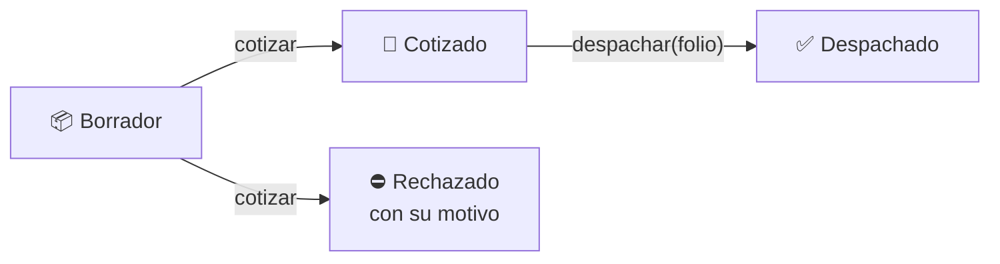

# 🚛 Carril E10 · Cotizador de cruce fronterizo

```
   ___________________   ____
  |  E10 · CARGA      | |__\_\_
  |  NUEVO LAREDO ⇄ TX| |  E10 |
  '-(@)----------(@)--' '-(@)--'
 ───────── Puente Comercio Mundial ─────────
```

> **Diez carriles de aduana, uno solo para nosotros.**
> Aquí cada embarque se forma en el carril E10: se revisa, se cotiza al centavo y, si trae sus papeles,
> cruza. Si no, se regresa con su motivo escrito.

Proyecto del segundo parcial de **Programación Multiparadigma** (ITNL): el mismo cotizador escrito dos
veces, en dos paradigmas, y los dos tienen que dar **los mismos centavos**.

| | Dónde | Paradigma | Estado |
|---|---|---|---|
| ⚙️ **El motor** | [`motor/`](motor/) | Funcional · Elixir | ✅ Completo · etiqueta `hito-1` |
| 🧩 **El modelo** | [`src/modelo.ts`](src/modelo.ts) | Tipos · TypeScript | 🚧 En construcción |

---

## 🛃 Lo que pasa en el carril



Un embarque llega como **borrador**. Si pasa la revisión, sale **cotizado**; si no, **rechazado**
con su motivo. Solo uno cotizado se puede **despachar**, y en el modelo eso no es una regla que
haya que recordar: lo demás **no compila**.

## 💰 Nuestra variante tarifaria

Todos los equipos construyen el mismo cotizador, pero cada carril cobra distinto. El del E10:

| Concepto | Valor |
|---|---|
| Tarifa | $31.50 por km |
| Cuota del puente | Comercio Mundial $380 · Colombia $375 |
| Descuento por volumen | 5 % para **más de** 10,000 kg (10,000 exactos no lo llevan) |
| Recargo por tipo | refrigerada 18 % · peligrosa 30 % + $500 · sobredimensionada 35 % + $1,500 |
| Base del recargo | el **subtotal** (flete + cuota del puente) |
| Cotización mínima | $2,700 |
| Peso máximo | 30,000 kg (la sobredimensionada con permiso puede pasarlo) |

Todo se calcula en **centavos enteros**, y los porcentajes redondean el medio centavo hacia arriba.
Ningún número de esta tabla está escrito en el código: todo llega como `reglas`.

## 🗺️ El repositorio

```
cotizador-e10/
├── motor/            ⚙️  el motor en Elixir: validar, calcular y resumir un lote
├── src/modelo.ts     🧩  el modelo en TypeScript: los estados del embarque como tipos
├── tests/            🧪  pruebas de aceptación del docente (no se editan)
├── talleres/         📝  entregas individuales, una carpeta por fecha
└── .github/          🤖  CI: el motor y el modelo se verifican en cada push
```

## ▶️ Cómo correrlo

```bash
# El modelo (TypeScript): tipos, linter y pruebas, lo mismo que corre CI
npm install
npm run verificar

# El motor (Elixir)
cd motor
mix test
mix format --check-formatted
```

| Comando | Qué hace |
|---|---|
| `npm run verificar` | Tipos, análisis estático y pruebas. Es lo mismo que corre CI |
| `npm test` | Solo pruebas |
| `npm run lint` | Solo análisis estático |
| `cd motor && mix test` | Las 16 pruebas de aceptación del motor |

## 🚦 Reglas del carril

1. **Nadie se mete directo a `main`.** Se trabaja en una rama corta y se abre un PR.
2. **Cada PR pasa CI en verde** para poder integrarse.
3. **Cada PR se liga a un issue.**
4. **Los commits siguen Conventional Commits** y describen el **propósito** del cambio, no su
   mecánica.

| Mal | Bien |
|---|---|
| `fix: cambios` | `fix: aplica el descuento por volumen exactamente en 1000 kg` |
| `update codigo` | `test: cubre el límite inferior del descuento por volumen` |
| `wip` | `refactor: extrae la tabla de recargos del cálculo` |

> El mensaje de commit es la evidencia de que entendiste lo que hiciste.
> Si no puedes describir el propósito en una línea, probablemente no lo entendiste.

## 🏷️ Hitos

| Etiqueta | Qué marca | |
|---|---|---|
| `hito-1` | El motor completo: 16 de 16 pruebas | ✅ |
| `parcial-2` | Motor + modelo: la entrega final | 🚧 |

---

**Equipo E10** · [@Blurry-gg](https://github.com/Blurry-gg) · [@itsvlqz](https://github.com/itsvlqz)
Instituto Tecnológico de Nuevo Laredo · Programación Multiparadigma · 2026
